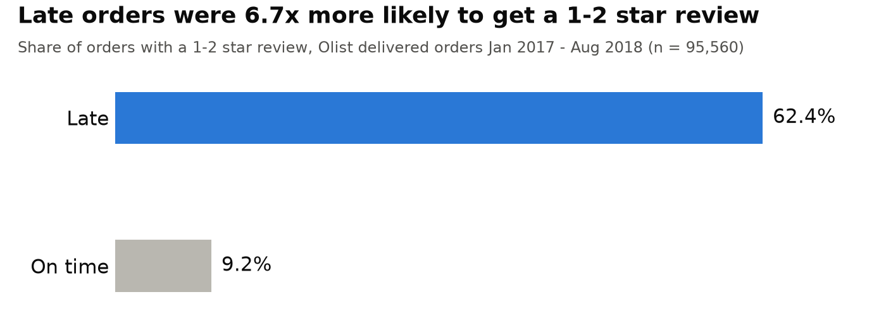
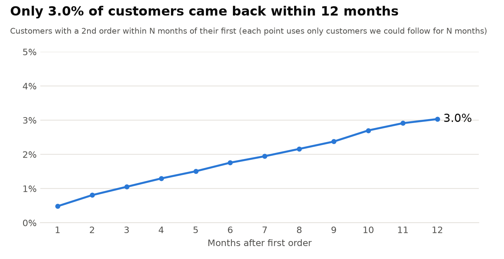
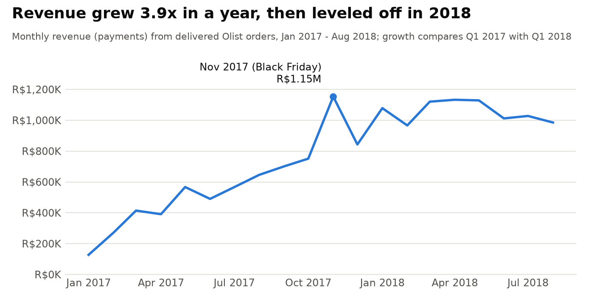

# E-Commerce Customer Analysis: What Drives Satisfaction and Repeat Purchases?

An analysis of ~96,000 orders from Olist, a Brazilian online marketplace, using **SQL (SQLite)** and **Python (pandas, matplotlib)**.

**Question:** What drives customer satisfaction and repeat purchases on an online marketplace?

## Key findings

### 1. Late deliveries are the biggest driver of bad reviews


- **62.4% of late orders got a 1–2 star review, vs 9.2% of on-time orders (6.7x more likely).**
- Late orders averaged **2 points lower** on the 1–5 star scale.
- 6.8% of orders arrived after the estimated delivery date. Delivery times vary widely by state: customers in São Paulo waited **8.7 days** on average, while customers in Bahia waited **19.3 days**.

### 2. Almost no one comes back


- **Only 3% of customers placed a second order within a year.**
- Returns trickle in at about a quarter of a percent per month, with no early spike, which suggests customers aren't being prompted to come back.
- This isn't just a short data window: even customers who had 12–19 months to return came back only 1.6–4.2% of the time (cohort analysis).

### 3. Revenue grew fast, then leveled off


- Monthly revenue grew **3.9x** from Q1 2017 to Q1 2018, then **plateaued at about R$1.0–1.1M per month** through 2018.
- Average order value stayed flat at **~R$160**, so growth came from **more orders, not bigger orders**.
- The peak month was **November 2017 (Black Friday, R$1.15M)**, followed by a drop in December as holiday shopping moved earlier.
- Revenue is concentrated: **São Paulo alone is 37% of revenue**, and the top 3 states are about 60%.
- **Health & beauty** is the top category (R$1.23M in item sales). Top categories win either on volume (bed/bath, furniture at ~R$90 per item) or on price (watches & gifts at ~R$199 per item).

## Recommendation

1. **Fix late deliveries first**, especially for states far from São Paulo. Late orders are 6.7x more likely to get a bad review, and bad reviews scare off new buyers.
2. **Give customers a reason to come back.** Start with post-purchase follow-ups and reorder reminders for health & beauty, the top category and one that people naturally rebuy.
3. **Retention is the next growth lever.** New-order growth has flattened, and almost all revenue comes from first-time buyers.

**Caveat:** the link between late delivery and bad reviews is a correlation. Late orders may also differ in other ways (distance, product category), so a next step would be to compare late vs on-time orders within the same state and category.

## Data

[Brazilian E-Commerce Public Dataset by Olist](https://www.kaggle.com/datasets/olistbr/brazilian-ecommerce) (Kaggle): ~100K orders from 2016–2018 across 9 linked tables (orders, customers, order items, payments, reviews, products, sellers, geolocation, category translations).

The raw data is not included in this repo. Download it from Kaggle and unzip the CSVs into `data/raw/`.

## Method

1. **Load:** loaded all 9 CSVs into a SQLite database.
2. **Clean:** built SQL views that keep only delivered orders from Jan 2017–Aug 2018 (the 20 full months in the data), compute delivery time and a late flag, translate category names to English, and keep one review per order (using a `ROW_NUMBER()` window function).
3. **Analyze in SQL:** monthly revenue and order counts, top categories and states, repeat-customer rate, and review scores for late vs on-time orders. Payments were summed per order before joining to avoid double counting split payments.
4. **Analyze in Python:** cohort retention by first-purchase month, plus charts in matplotlib.

Customers are tracked with `customer_unique_id`, since `customer_id` changes with every order.

## Repo structure

```
sql/        SQL queries and the clean views (03_clean_views.sql)
src/        Python scripts: loading, views, cohort analysis, charts
reports/figures/   Charts used in this README
data/       (not in repo) raw CSVs and the SQLite database
```

## How to run it

```
pip install -r requirements.txt
python src/load_db.py              # build data/olist.db from data/raw/
python src/create_views.py         # create the clean views
python src/run_query.py sql/06_monthly_revenue.sql   # run any query
python src/cohort_retention.py
python src/chart_late_reviews.py
python src/chart_retention.py
python src/chart_monthly_revenue.py
```

## Tools

SQL (SQLite) · Python · pandas · matplotlib
